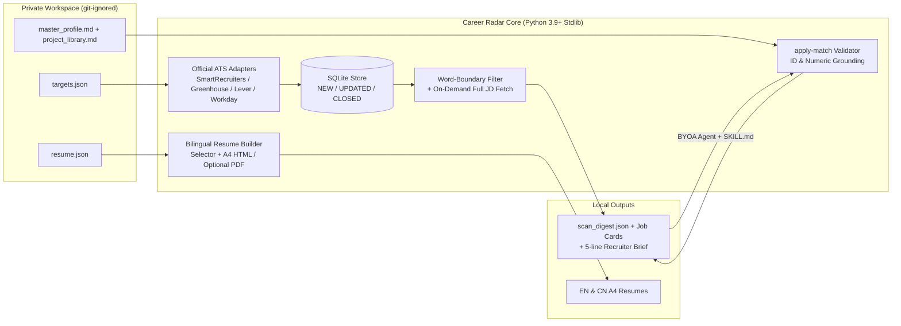

# Career Radar

**Local-First Official ATS Job Radar & Evidence-Grounded Resume Kit**

English | [中文](README_ZH.md)

`Python 3.9+` · `Zero Core Dependencies` · `Local-First` · `MIT License`

---

## Why Career Radar?

Most job-search tooling falls into two traps: fragile scrapers that hammer aggregated boards, and AI resume tools that invent metrics to sound impressive.

**Career Radar** takes a different approach:

1. **Track official ATS endpoints directly**: Pull incremental job changes (`NEW`, `UPDATED`, `UNCHANGED`, `CLOSED`) straight from public **SmartRecruiters**, **Greenhouse**, **Lever**, and **Workday** APIs into local SQLite — with truncation protection so partial scans never falsely close unseen roles.
2. **Ground every claim in verified evidence**: Maintain one private `master_profile.md` + `project_library.md` with explicit `[Verified]`, `[Self-reported]`, and `[Gap]` boundaries. `apply-match` blocks unknown evidence IDs and ungrounded numeric claims before writing a job card.
3. **Bring Your Own Agent ($0 extra API cost)**: `scan` exports `scan_digest.json` plus on-demand full JD text so your existing AI coding assistant (Antigravity, Claude Code, Codex) can match jobs using [skills/career-radar-matcher/SKILL.md](skills/career-radar-matcher/SKILL.md) without paying for another LLM API wrapper.
4. **Tailor clean bilingual resumes deterministically**: Select the top-N relevant projects for a JD without rewriting your facts, and render print-ready A4 **English & Chinese** HTML (or optional ReportLab PDF).

---

## Comparison

| Dimension | Career Radar | Generic Job Scrapers | Typical AI Resume Rewriters |
| :--- | :--- | :--- | :--- |
| **Job Source** | Official ATS JSON APIs (`SmartRecruiters` / `Greenhouse` / `Lever` / `Workday`) | Aggregators / brittle HTML scrapers | Manual copy-paste |
| **Incremental Tracking** | Local SQLite diff + truncation-safe `CLOSED` tracking | Usually CSV dumps | None |
| **AI Cost Model** | **BYOA** (`$0` extra API fee via existing agent subscription + Skill) | None or paid SaaS | Paid subscription / API key |
| **Hallucination Guard** | Deterministic `apply-match` blocks ungrounded IDs & numbers | N/A | Often invents percentages and ownership |
| **Privacy** | `workspace/` & `output/` git-ignored locally | Local or cloud | Uploads CV to third-party servers |

---

## Architecture



---

## 30-Second Quickstart

Try the complete offline pipeline using synthetic fixtures (`0` external packages required):

```bash
git clone https://github.com/Zack0303/career-radar.git
cd career-radar

# 1. Run the 23 automated unit & CLI tests
PYTHONPATH=src python3 -m unittest discover -s tests -v

# 2. Run the offline end-to-end demo (SQLite diffs, job cards, EN/CN HTML resumes)
PYTHONPATH=src python3 -m career_radar demo --out output/demo
```

> Note: Replace the clone URL with your fork if running via GitHub Actions.

### Monitor Real Official ATS Boards Locally

```bash
# 1. Scaffold your private git-ignored workspace/
PYTHONPATH=src python3 -m career_radar init --dir workspace

# 2. Edit workspace/targets.json (or test with presets/china-mnc-industrial.json)
PYTHONPATH=src python3 -m career_radar scan \
  --config presets/china-mnc-industrial.json \
  --db workspace/career_radar.db \
  --out output/scan \
  --max-pages 1

# 3. Inspect active jobs and scan history
PYTHONPATH=src python3 -m career_radar status --db workspace/career_radar.db
```

### Grounded Job Matching (BYOA) & Bilingual Resume Export

1. Point your AI assistant (Antigravity, Claude Code, or Codex) at [skills/career-radar-matcher/SKILL.md](skills/career-radar-matcher/SKILL.md) to match `output/scan/scan_digest.json` against `workspace/master_profile.md` + `workspace/project_library.md`.
2. Validate and write the grounded job card (`exit code 2` if any evidence ID or metric is ungrounded):

```bash
PYTHONPATH=src python3 -m career_radar apply-match \
  --match-json output/scan/match.json \
  --profile workspace/master_profile.md \
  --projects workspace/project_library.md \
  --out output/scan/jobs/verified-card.md
```

3. Select top-matching projects for a JD and render A4 bilingual resumes (add `--format pdf` after `pip install "career-radar[pdf]"`):

```bash
PYTHONPATH=src python3 -m career_radar resume \
  --resume workspace/resume.json \
  --out output/resumes \
  --lang both \
  --format html \
  --jd output/scan/jobs/verified-card.md \
  --max-projects 3
```

---

## Sample Output (`apply-match` Verified Card)

The [example card](examples/sample_grounded_job_card.md) illustrates a fictional operations analyst role using [synthetic evidence](examples/demo_evidence.md) and a [sample match](examples/demo_match.json). Run `apply-match` with your own private evidence to validate a real card.

---

## Current Status & Roadmap (v0.1.0)

| Milestone | Status | Scope |
| :--- | :--- | :--- |
| **M0 — Offline Core & Templates** | ✅ Done | Domain models, deterministic hash, SQLite diff store, Stage-1 filter, EN/CN HTML resume renderer, `init`/`demo` CLI |
| **M1 — Live Official ATS Adapters** | ✅ Done | SmartRecruiters, Greenhouse, Lever, Workday HTTP fetchers, isolated `scan_runs` error tracking, `scan`/`status` CLI |
| **M2 — Grounded Matching (BYOA)** | ✅ Done | Word-boundary matching, on-demand full JD fetch, `apply-match` ID & numeric validator, `career-radar-matcher` Skill |
| **M3 — Resume Builder & Safe Closing** | ✅ Done | Truncation-safe `FetchBatch` (`CLOSED` guard), deterministic JD project selector, optional ReportLab PDF exporter, `resume` CLI |
| **M4 — v0.1 Release Packaging** | ✅ Done | MIT `LICENSE`, CI & daily scan GitHub Actions templates, bilingual READMEs, genuine sample card |
| **v0.2 — Next** | ⏳ Planned | Read-only MCP Server for direct IDE/agent querying, optional headless OpenAI-compatible matcher for CI cron |

---

## Privacy & Docs

- **Local-first by design**: `workspace/`, `output/`, `*.db`, and `.env` are excluded in `.gitignore`. No personal profile data or proprietary employer records are stored in the repository.
- **Project docs**: [docs/PRD.md](docs/PRD.md) · [docs/ARCHITECTURE.md](docs/ARCHITECTURE.md) · [PROGRESS.md](PROGRESS.md) · [CHANGELOG.md](CHANGELOG.md)
