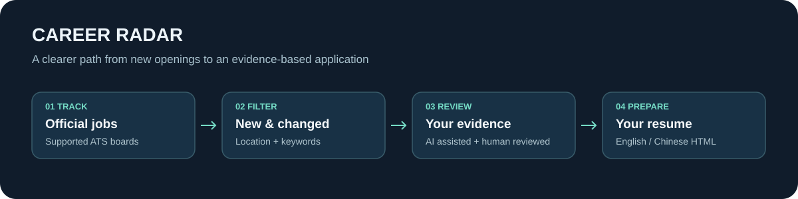

# Career Radar

**Track jobs from official company hiring systems, review your fit against your own evidence, and prepare a tailored resume.**

[中文](README_ZH.md) · [Try the demo](#try-the-offline-demo) · [Use with real jobs](docs/GETTING_STARTED.md) · [Example job card](examples/sample_grounded_job_card.md) · [Contribute](CONTRIBUTING.md)



**Python 3.9+** · Core uses the Python standard library · Local-first · [MIT license](LICENSE)

Career Radar is an early-stage, command-line tool for job seekers comfortable editing a configuration file. It monitors configured company career boards, records changes locally, and helps prepare applications. You choose the companies, locations, keywords, and evidence; **it does not apply for jobs on your behalf**.

## What you get

- **Track:** fetch jobs from supported public SmartRecruiters, Greenhouse, Lever, and Workday endpoints; compare scans in a local SQLite database.
- **Filter:** select new or updated jobs using location and keyword rules. An incomplete scan cannot mark unseen jobs as closed.
- **Review:** optionally use your AI assistant and personal evidence files to draft a match. The validator checks evidence IDs, some numeric claims, and output structure; you review the result.
- **Prepare:** select projects by job-description keywords and generate English and Chinese HTML resumes. PDF export is optional.

> **Example · Operations Data Analyst, Guangzhou**
>
> Evidence: SQL inventory reporting (`P1`); Python forecasting demo (`P3`)
>
> Gap to review: production forecasting experience not demonstrated.

The [sample job card](examples/sample_grounded_job_card.md) and [evidence](examples/demo_evidence.md) use fictional data. They show the kind of result you can inspect before sharing; `PASSED` is a limited automated check, not proof that every statement is true.

## Try the offline demo

Requires Git and Python 3.9 or newer. No account, network access after cloning, or third-party Python packages are needed for the demo.

```bash
git clone https://github.com/Zack0303/career-radar.git
cd career-radar
PYTHONPATH=src python3 -m career_radar demo --out output/demo
```

The command prints a JSON summary. Open `output/demo/jobs/` for fictional job cards and `output/demo/resumes/` for two HTML resumes. Running it again against the same output directory reuses its demo database; delete that **demo output directory** if you want a fresh first-run result.

On Windows PowerShell, replace `PYTHONPATH=src` with `$env:PYTHONPATH = "src"` on a separate line, followed by `python -m career_radar ...`.

## Use with real jobs

1. Initialize private working files:

   ```bash
   PYTHONPATH=src python3 -m career_radar init --dir workspace
   ```

2. Edit `workspace/targets.json`: replace the example company entries with actual supported ATS boards, and choose your locations and keywords. Fill in the other workspace files only when you are ready to use matching and resume generation.
3. Scan using **your edited configuration**:

   ```bash
   PYTHONPATH=src python3 -m career_radar scan \
     --config workspace/targets.json \
     --db workspace/career_radar.db \
     --out output/scan --max-pages 5
   ```

4. Inspect `output/scan/scan_digest.json`, including its `errors` list, and open the cards in `output/scan/jobs/`. Keep the same database between scans to track changes.

The [step-by-step guide](docs/GETTING_STARTED.md) covers configuration fields, outputs, matching, resume generation, and troubleshooting. Public ATS interfaces vary by company and can change; support for an ATS type is not a guarantee that every company board works.

## What to know before using it

- **Evidence is not automatic fact-checking.** The validator detects unknown evidence IDs, some unsupported numeric tokens, and certain format errors. It does not verify semantic claims, associate every number with a particular evidence ID, or establish whether your sources are true. Review every result.
- **The AI step is optional and external.** Scanning, rule filtering, and the demo do not require an AI service. Deep matching requires an assistant you choose; its cost and handling of any profile you share depend on that service.
- **Local-first is not the same as never leaving your computer.** `workspace/`, `output/`, databases, and `.env` are git-ignored by default. Network scans contact the configured employers' services; sharing files with an AI assistant may send data to its provider. Check files before sharing or committing.
- **Scheduling is a template.** The included GitHub Actions scan runs manually by default; its schedule is disabled and its database is not persisted between runs. It is not yet a reliable cross-run daily change tracker.
- This is **v0.1**, not an unattended job-application service. A read-only MCP server and headless matching are planned, not included.

## Development and feedback

```bash
PYTHONPATH=src python3 -m unittest discover -s tests -v
```

See [CONTRIBUTING.md](CONTRIBUTING.md) to report a problem or contribute, [CHANGELOG.md](CHANGELOG.md) for changes, and [architecture](docs/ARCHITECTURE.md) for implementation details. Please remove private information from reports and examples.
