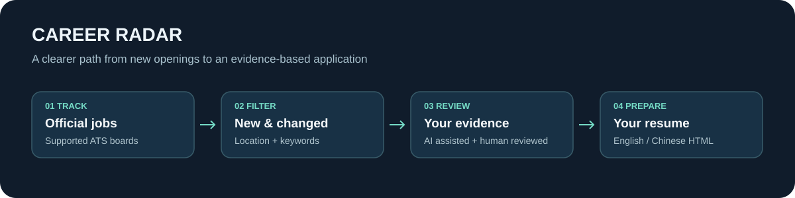

# Career Radar

**追踪目标公司的官方岗位，用自己的真实证据评估匹配，并准备针对性简历。**

[English](README.md) · [体验离线示例](#体验离线示例) · [配置真实岗位](docs/GETTING_STARTED.md) · [示例岗位卡](examples/sample_grounded_job_card.md) · [参与贡献](CONTRIBUTING.md)



**Python 3.9+** · 核心仅用 Python 标准库 · 本地优先 · [MIT 许可证](LICENSE)

Career Radar 是一个早期命令行工具，适合愿意编辑配置文件的求职者。你选择公司、地点、关键词和个人证据；工具帮助你追踪岗位变化、整理分析并生成简历。**它不会替你自动投递。**

## 能做什么

- **追踪：**从支持的 SmartRecruiters、Greenhouse、Lever、Workday 公开招聘接口获取岗位，用本地 SQLite 比较扫描结果。
- **筛选：**按地点和关键词筛选新增或更新岗位；扫描不完整时不会把未看到的岗位误标为下架。
- **评估：**可选择让 AI 助手对照你的档案起草匹配分析；程序检查证据编号、部分数字和格式，结果仍需你复核。
- **准备：**按岗位描述中的关键词选取项目，生成中英文 HTML 简历；PDF 为可选功能。

> **示例 · 广州运营数据分析师**
>
> 相关证据：SQL 库存报表（`P1`）；Python 需求预测演示（`P3`）
>
> 待核实的缺口：尚未展示生产环境预测经验。

[示例岗位卡](examples/sample_grounded_job_card.md)和[示例证据](examples/demo_evidence.md)均为虚构数据。卡片上的 `PASSED` 只表示通过有限的程序检查，不代表每句话都已被证明真实。

## 体验离线示例

需要 Git 和 Python 3.9 或更高版本。克隆完成后，演示无需联网、账号或第三方 Python 包。

```bash
git clone https://github.com/Zack0303/career-radar.git
cd career-radar
PYTHONPATH=src python3 -m career_radar demo --out output/demo
```

命令会输出 JSON 摘要。打开 `output/demo/jobs/` 查看虚构岗位卡，打开 `output/demo/resumes/` 查看中英文 HTML 简历。再次运行会复用示例数据库；如果想重新体验首次扫描，可删除 **demo 输出目录**后再运行。

Windows PowerShell 用户先单独运行 `$env:PYTHONPATH = "src"`，再运行 `python -m career_radar demo --out output/demo`。

## 开始追踪真实岗位

1. 创建私人工作文件：

   ```bash
   PYTHONPATH=src python3 -m career_radar init --dir workspace
   ```

2. 编辑 `workspace/targets.json`，将示例公司替换为支持的真实招聘系统地址，并设置地点和关键词。需要匹配与生成简历时，再填写其他私人档案。
3. 使用**你编辑过的配置**进行扫描：

   ```bash
   PYTHONPATH=src python3 -m career_radar scan \
     --config workspace/targets.json \
     --db workspace/career_radar.db \
     --out output/scan --max-pages 5
   ```

4. 查看 `output/scan/scan_digest.json` 中的结果和 `errors`，以及 `output/scan/jobs/` 中的岗位卡。每次保留并使用同一个数据库，才能比较岗位变化。

[详细使用指南（英文）](docs/GETTING_STARTED.md)介绍配置字段、输出、匹配、简历生成和常见问题。招聘接口会因公司而异，也可能变化；支持某种 ATS 不代表所有使用该系统的公司都一定能连接。

## 使用前需要知道

- **证据校验不等于事实核查。** 它检查未知证据编号、部分未出现的数字和输出格式，不能判断每句话的真实含义，也不能保证数字属于所引用的那条证据。对外使用前请逐条复核。
- **AI 匹配是可选的外部步骤。** 扫描、规则筛选和离线演示不需要 AI 服务。深度匹配需要你选择的助手；费用及其对档案的处理方式取决于该服务。
- **本地优先不代表数据永远不离开电脑。** `workspace/`、`output/`、数据库和 `.env` 默认被 Git 忽略。扫描会连接所配置公司的招聘服务；把资料交给 AI 助手可能传给其服务提供方。分享或提交前请检查文件。
- **定时扫描目前只是模板。** GitHub Actions 默认手动触发，定时配置尚未启用，数据库也不会跨运行保存；暂时不能直接作为可靠的每日增量追踪。
- 项目处于 **v0.1 早期阶段**。只读 MCP Server 和无人值守 AI 匹配仍在规划中。

## 开发与反馈

```bash
PYTHONPATH=src python3 -m unittest discover -s tests -v
```

如何报告问题或参与开发，请看[贡献指南](CONTRIBUTING.md)；更新见 [CHANGELOG.md](CHANGELOG.md)，实现细节见[架构文档](docs/ARCHITECTURE.md)。提交问题前，请删除简历、个人联系方式等私人信息。
