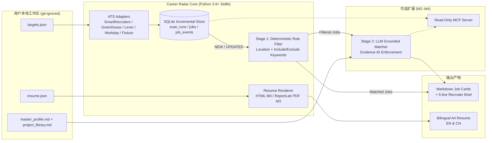
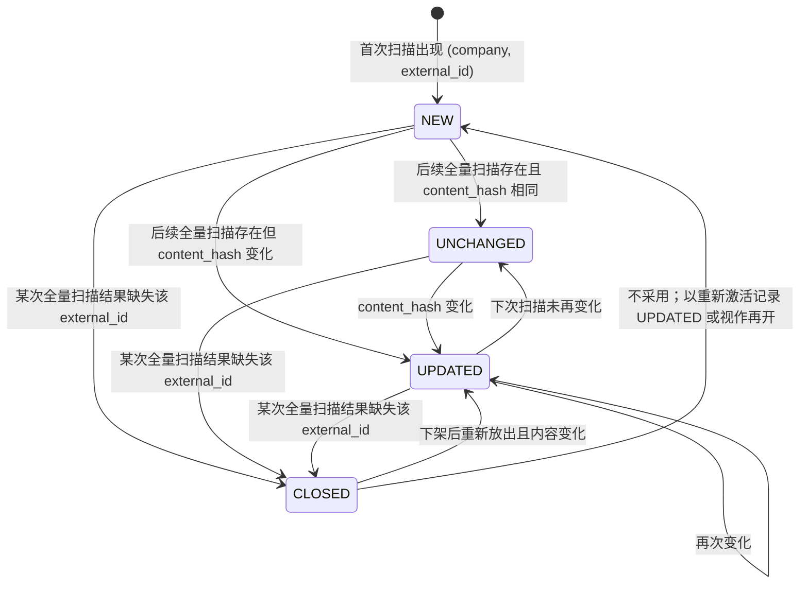

# Career Radar — 架构设计文档（Architecture）

> 本文档定义 `career-radar` 的系统分层、核心数据契约、ATS 公开接口规范、SQLite 增量存储 Schema 及防幻觉校验机制。

---

## 1. 系统整体架构



---

## 2. 分层设计与依赖隔离

为保证开源开箱体验与零配置启动，系统分为两层：

1. **Core 层（`Python 3.9+` 纯标准库，M0 已完成）**
   - `models.py`：不可变领域模型与确定性哈希。
   - `adapters/`：ATS 接口协议、端点构建器及离线 `FixtureAdapter`。
   - `storage/sqlite_store.py`：增量去重、关闭检测与事件日志。
   - `matcher/rule_matcher.py`：零成本地点与关键词规则过滤 + 岗位卡渲染。
   - `resume/renderer.py`：零依赖打印级 A4 中英双语 HTML 简历渲染器。
   - `cli.py`：命令行入口（`init`、`demo`；后续扩展 `scan`、`match`、`resume`）。
2. **可选扩展层（Extras，按需安装，M1–M4 引入）**
   - `[pdf]`：`reportlab`（A4 双语 PDF 生成）。
   - `[llm]`：`openai` / `anthropic` 等客户端或标准 HTTP 适配。
   - `[yaml]`：`PyYAML`（支持 YAML 格式配置）。
   - `[mcp]`：`mcp`（只读 MCP Server 暴露）。

---

## 3. 核心领域模型与状态机

### 3.1 枚举定义
- `ATSProvider`：`smartrecruiters` | `greenhouse` | `lever` | `workday` | `fixture`
- `JobChangeType`：`new` | `updated` | `unchanged` | `closed`
- `EvidenceLevel`：`verified` | `self_reported` | `gap`

### 3.2 岗位增量状态流转



> 注：在当前 SQLite 存储实现中，若已标记 `is_active = 0`（`CLOSED`）的岗位在后续全量扫描中重新出现：若 `content_hash` 变化记为 `UPDATED` 并恢复 `is_active = 1`；若一致则恢复为活跃态并记为 `UPDATED`（或重开事件），确保不会漏掉重新开放的岗位。

### 3.3 确定性内容哈希（`content_hash`）
`JobPosting.compute_content_hash()` 对以下规范化（去首尾空白、统一小写/换行）字段做 SHA-256 摘要：
- `title`
- `location`
- `department`
- `url`
- `description`

---

## 4. 官方 ATS 适配器契约与公开接口规范

所有适配器遵循 `ATSAdapter` Protocol：
```python
class ATSAdapter(Protocol):
    provider: ATSProvider
    def fetch_jobs(self, target: TargetCompany) -> list[JobPosting]: ...
```

| Provider | 公开接口形态（M1 实施目标） | 关键实现注意点 |
| :--- | :--- | :--- |
| **SmartRecruiters** | `GET https://api.smartrecruiters.com/v1/companies/{slug}/postings` | 分页参数 `offset` / `limit`；列表接口不含完整正文时，按需请求 `.../postings/{id}` 补全 `description`。 |
| **Greenhouse** | `GET https://boards-api.greenhouse.io/v1/boards/{slug}/jobs?content=true` | `?content=true` 可一次返回带 HTML 正文的岗位；解析时需清洗 HTML 标签为纯文本。 |
| **Lever** | `GET https://api.lever.co/v0/postings/{slug}?mode=json` | 返回 JSON 数组；地点、团队在 `categories` 对象中，正文在 `descriptionPlain`。 |
| **Workday** | `POST https://{host}/wday/cxs/{tenant}/{site}/jobs` | 各公司 `host`/`tenant`/`site` 路径结构不完全一致，由用户填入完整看板 URL 自动解析；分页受限流保护，需保守间隔与独立错误隔离。 |

> **实现状态说明**：截至 **M1**，上述 4 类适配器已基于 Python 标准库 `urllib.request` 完成真实 HTTP 拉取、分页、HTML 清洗与 `scan` 单站错误隔离。**M2** 将以 **方案 A（BYOA：Antigravity / Claude Code / Codex 通过 Skill / MCP 直接消费 `scan_digest.json`）** 作为主要零额外 API 成本匹配路径，并保留可选 OpenAI 兼容 API 回退接口。

---

## 5. SQLite 增量存储 Schema

```sql
CREATE TABLE IF NOT EXISTS scan_runs (
    id INTEGER PRIMARY KEY AUTOINCREMENT,
    company_name TEXT NOT NULL,
    provider TEXT NOT NULL,
    started_at TEXT NOT NULL,
    finished_at TEXT,
    status TEXT NOT NULL,
    new_count INTEGER NOT NULL DEFAULT 0,
    updated_count INTEGER NOT NULL DEFAULT 0,
    unchanged_count INTEGER NOT NULL DEFAULT 0,
    closed_count INTEGER NOT NULL DEFAULT 0,
    error_message TEXT
);

CREATE TABLE IF NOT EXISTS jobs (
    id INTEGER PRIMARY KEY AUTOINCREMENT,
    company_name TEXT NOT NULL,
    provider TEXT NOT NULL,
    external_id TEXT NOT NULL,
    title TEXT NOT NULL,
    location TEXT NOT NULL,
    department TEXT NOT NULL,
    url TEXT NOT NULL,
    description TEXT NOT NULL,
    content_hash TEXT NOT NULL,
    first_seen_at TEXT NOT NULL,
    last_seen_at TEXT NOT NULL,
    is_active INTEGER NOT NULL DEFAULT 1,
    raw_json TEXT NOT NULL,
    UNIQUE(company_name, external_id)
);

CREATE TABLE IF NOT EXISTS job_events (
    id INTEGER PRIMARY KEY AUTOINCREMENT,
    scan_run_id INTEGER NOT NULL,
    company_name TEXT NOT NULL,
    external_id TEXT NOT NULL,
    event_type TEXT NOT NULL,
    old_hash TEXT,
    new_hash TEXT,
    created_at TEXT NOT NULL,
    FOREIGN KEY(scan_run_id) REFERENCES scan_runs(id)
);
```

---

## 6. 防幻觉与证据校验机制（M2 约束）

当 M2 引入 LLM 做深度岗位匹配时，所有生成输出必须通过本地确定性校验器：
1. **证据 ID 强制引用**：每条匹配声明必须绑定 `master_profile.md` 或 `project_library.md` 中真实存在的编号（如 `P1`、`E2`）。
2. **禁止指标自造**：若输出中出现数字/百分比，而在被引用的原始证据片段中未出现该数字，标记为 `UNGROUNDED_CLAIM` 并拦截提醒。
3. **显式缺口输出**：强制要求输出 `gaps` 与 `questions_to_ask` 两个字段，并附带一段最多 5 行的 `Recruiter Brief` 供候选人或猎头快速对齐核心事实与边界。
